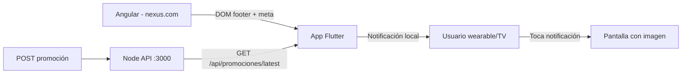

# Enlace sitio web ↔ dispositivos inteligentes (Nexus Nightclub)

## Objetivo

Conectar el sitio web **Nexus Nightclub** con un **widget Flutter** que simula un dispositivo inteligente (wearable / smart TV). Cuando se publica una promoción, el backend expone los datos y la app Flutter muestra una **notificación**; al abrirla, se despliega la **imagen** de la promoción.

## Arquitectura



## 1. Enlace desde el DOM

El sitio declara públicamente dónde está la API para que un dispositivo se registre:

**`src/index.html`**
- `<link rel="manifest" href="/api/widget/manifest" />`
- `<meta name="nexus-widget-api" content=".../api/promociones/latest" />`

**Footer (`app-shell.html`)**
- Enlaces visibles a `/api/promociones/latest` y `/api/widget/manifest`
- Atributo `data-nexus-widget="true"` para identificar el bloque de enlace

## 2. Backend — qué datos se transfieren

### `GET /api/promociones/latest`

Respuesta ejemplo:

```json
{
  "id": "promo-2x1-cocteles",
  "type": "promocion_nueva",
  "title": "2x1 en cócteles",
  "body": "Promoción destacada todos los viernes en Nexus Nightclub.",
  "imageUrl": "http://localhost:3000/uploads/promo-default.svg",
  "deepLink": "/inicio",
  "expiresAt": "2026-12-31T23:59:59.000Z",
  "createdAt": "2026-06-01T12:00:00.000Z"
}
```

| Campo | Tipo | Propósito |
|-------|------|-----------|
| `type` | string | Clasifica el evento para el widget (`promocion_nueva`) |
| `id` | string | Identificador único de la promoción |
| `title` | string | Título mostrado en la notificación |
| `body` | string | Texto corto de la notificación |
| `imageUrl` | string | Imagen que se despliega al abrir la notificación |
| `deepLink` | string | Ruta del sitio web relacionada |
| `expiresAt` | ISO-8601 | Vigencia; el widget ignora promos vencidas |
| `createdAt` | ISO-8601 | Fecha de publicación |

### `POST /api/promociones`

Publica una promoción nueva (dispara el flujo que consumirá el widget).

```json
{
  "title": "2x1 en cócteles",
  "body": "Todos los viernes",
  "imageUrl": "http://...",
  "imageBase64": "data:image/png;base64,..."
}
```

### `GET /api/widget/manifest`

Manifiesto para instalación/registro del widget: URLs de la API, dispositivos soportados y esquema de datos.

## 3. App Flutter (`flutter_app/`)

Simula el comportamiento del wearable:

1. Llama al backend (`ApiService`)
2. Muestra notificación local (`NotificationService`)
3. Al tocar la notificación abre `PromoDetailScreen` con `Image.network(imageUrl)`

### URL del API según dispositivo

| Entorno | URL |
|---------|-----|
| Windows / escritorio | `http://localhost:3000` |
| Emulador Android | `http://10.0.2.2:3000` |
| Celular físico | `http://TU_IP_LOCAL:3000` |

Puedes cambiarla al ejecutar:

```bash
flutter run --dart-define=API_BASE_URL=http://10.0.2.2:3000
```

## 4. Repositorio a favor del despliegue

| Recurso | Uso |
|---------|-----|
| `server/` | API versionada en Git; despliegue en VPS, Render, Railway, etc. |
| `server/uploads/` | Almacén de imágenes de promociones |
| `npm run api` | Levanta el backend local o en producción |
| `flutter_app/` | Cliente independiente; `flutter build apk` para Android / Wear OS |
| `src/index.html` + footer | El sitio publicado apunta siempre a la URL del API desplegado |
| Docker (`docker-compose.yml`) | Patrón de despliegue reproducible (Elasticsearch hoy; API mañana) |

**Flujo de despliegue recomendado**

1. Push a GitHub
2. CI despliega `server/` → `https://api.nexus.com`
3. CI despliega Angular → `https://nexus.com`
4. Actualizar `meta nexus-widget-api` con la URL de producción
5. Compilar Flutter con `--dart-define=API_BASE_URL=https://api.nexus.com`

## 5. Cómo ejecutar todo en local

Terminal 1 — API:

```bash
npm run api
```

Terminal 2 — Web:

```bash
npm start
```

Terminal 3 — Flutter (requiere [Flutter SDK](https://docs.flutter.dev/get-started/install)):

```bash
cd flutter_app
flutter create . --project-name nexus_widget
flutter pub get
flutter run
```

## 6. Prueba rápida sin Flutter

```bash
curl http://localhost:3000/api/promociones/latest
```

```bash
curl -X POST http://localhost:3000/api/promociones \
  -H "Content-Type: application/json" \
  -d "{\"title\":\"Ladies Night\",\"body\":\"Cover gratis antes de las 11 PM\"}"
```
